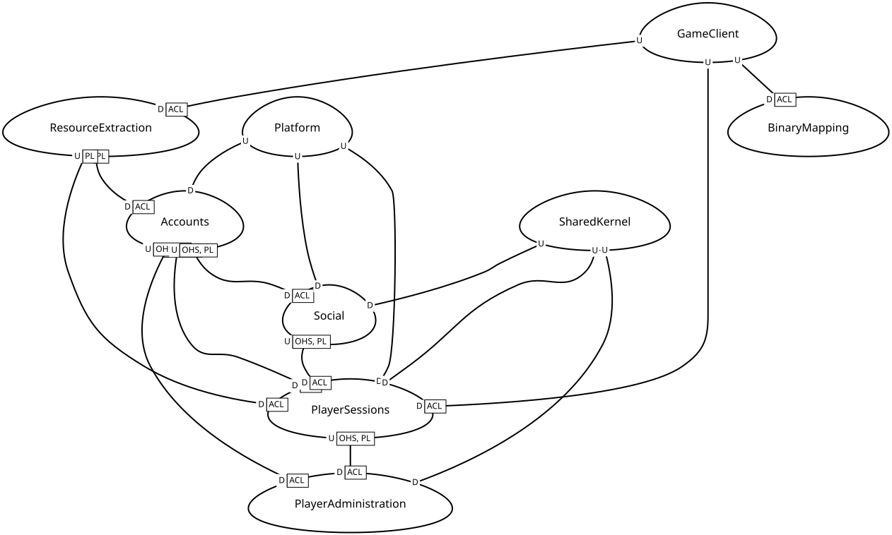

# Context map

See [naming bounded contexts](docs/bounded-contexts.md) for naming criteria and
a review of the names used in this map.

## wot-server

[Shared Kernel](src/shared_kernel/README.md) supplies the account ID model to
Player Administration, Player Sessions, and Social.
[Platform](src/platform/README.md) supplies shared codecs to Accounts and
Player Sessions, and tracing adapters to runtime infrastructure and server
composition. Both support boundaries are independent of their consumers.

[Accounts](src/accounts/README.md) publishes its application API and immutable
snapshots upstream of [Player Sessions](src/player_sessions/README.md), which adapts them into login
and garage sessions. Both translate external client data through anti-corruption
layers. Accounts' PostgreSQL adapter persists user state, including revision-checked
ammunition, tank/module research, vehicle purchases and module, equipment, consumable and directive loadouts, cosmetic ownership and outfits, shared depot stock and balance updates; its resource adapter builds
the garage projection. Player Sessions adapts shell, equipment, consumable, directive, camouflage, module and tank progression requests and publishes committed
inventory/balance changes and purchase receipts. Player Sessions owns the Mercury UDP adapter and binds
garage RPCs to the extracted script definitions. Both contexts use the shared
[client formats](src/platform/infrastructure/client_formats/README.md) infrastructure.

[Resource Extraction](tools/wot-extract/README.md) runs offline and publishes
the [bundle contract](tools/wot-resources/README.md) to Accounts and Player Sessions. The
extractor reads installed client packages and loose files. Accounts loads the
garage catalog from the bundle, and Player Sessions loads its ABI definitions and
component class metadata.

[Social](src/social/README.md) owns directed contacts and private conversation
membership, durable history and legacy per-player subscriptions. Accounts publishes a read-only SQL directory; Social owns its contact
table and consumes that directory through an anti-corruption adapter. Player Sessions
consumes Social application operations and adapts native XMPP, both legacy
messenger RPC versions, presence and committed participant delivery. See [social protocol](docs/social.md).

[Player Administration](src/player_administration/README.md) authenticates operators and adapts Accounts' player
listing and creation contract to HTTP and the React Admin dashboard.

[Binary Mapping](tools/wot-binary-map/src/binary_mapping/README.md) runs in its
own workspace package. It reads the external executable and produces offline
research artifacts. Catalog, Battles and Battle Allocation are future candidate
boundaries and do not appear as implemented contexts.

Editable models live in [docs/context-maps](docs/context-maps). Run
`cargo context-maps` to render them with the
[checksummed Rust tool](tools/wot-context-maps/README.md). Each context README documents its actual
layers and ubiquitous language; [server guide](docs/server.md) maps runtime sources
and integration contracts. The existing workflow validates and regenerates SVGs.
